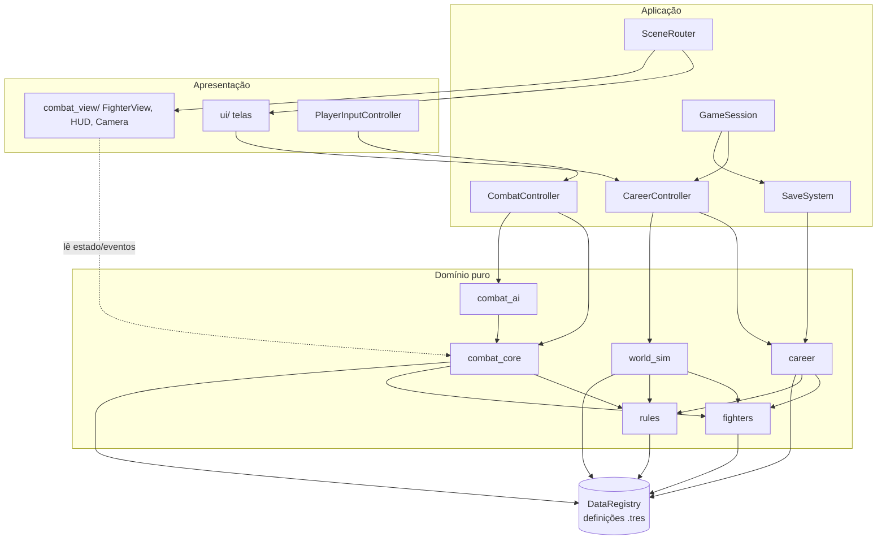
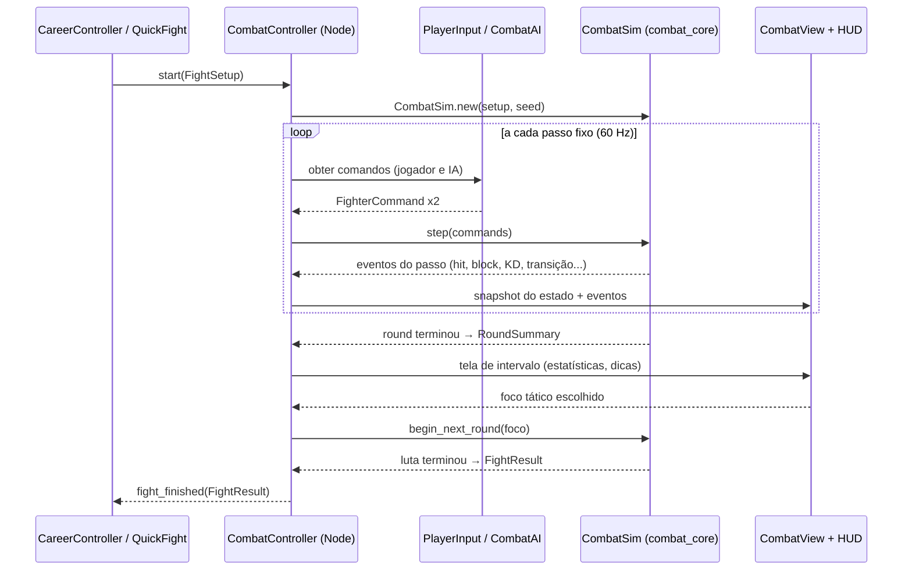
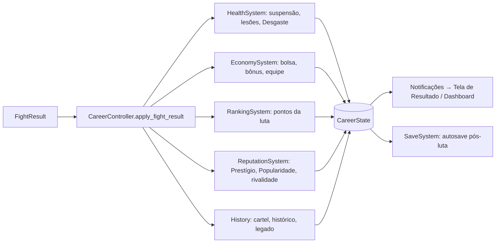
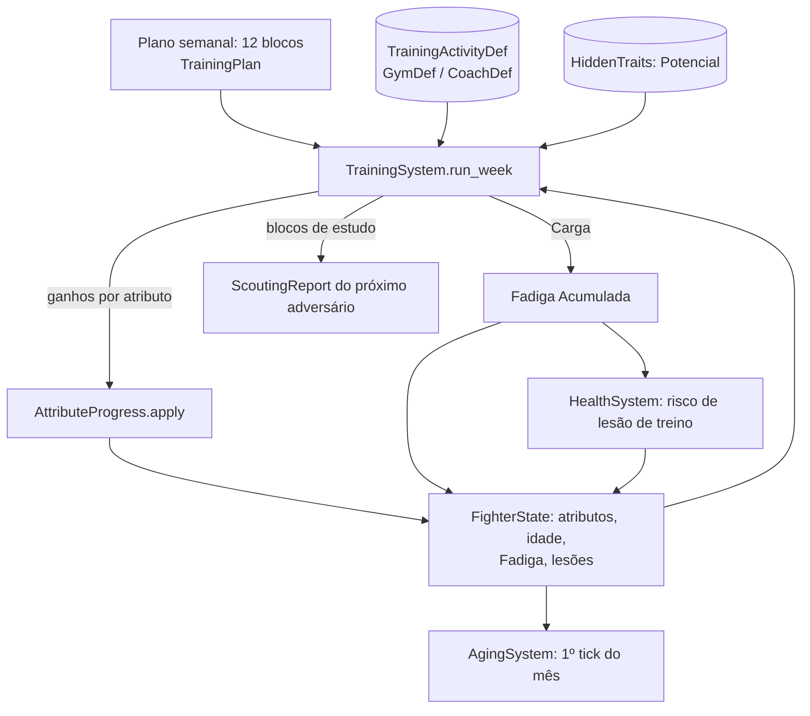

# ARCHITECTURE OVERVIEW — Projeto Jaula

> Versão 0.1 · Etapa 02 (Arquitetura técnica) · 2026-11-19
> Fonte de design: [GDD](../GDD.md) e documentos especializados (Etapa 01, aprovada em 2026-11-19).
> Decisões técnicas: [TECH_DECISIONS.md](TECH_DECISIONS.md) (`T-xxx`). Marcação: `APROVADA` · `RECOMENDAÇÃO` · `PENDENTE`. Nada aqui foi implementado ou testado.

Documentos desta pasta:

| Documento | Conteúdo |
|---|---|
| [PROJECT_STRUCTURE.md](PROJECT_STRUCTURE.md) | Árvore de diretórios e regras de localização |
| [GODOT_ARCHITECTURE.md](GODOT_ARCHITECTURE.md) | Cenas, nós, autoloads, sinais, recursos, máquinas de estado, ciclo de vida |
| [DATA_ARCHITECTURE.md](DATA_ARCHITECTURE.md) | Definições estáticas, estado dinâmico, IDs, serialização |
| [COMBAT_ARCHITECTURE.md](COMBAT_ARCHITECTURE.md) | Núcleo de simulação da luta, estados, IA, apresentação |
| [CAREER_ARCHITECTURE.md](CAREER_ARCHITECTURE.md) | Domínios da carreira, tick semanal, simulação do mundo |
| [SAVE_AND_TESTING.md](SAVE_AND_TESTING.md) | Persistência, versionamento, testes, recuperação |
| [CODING_STANDARDS.md](CODING_STANDARDS.md) | Convenções de GDScript e do projeto |
| [TECH_DECISIONS.md](TECH_DECISIONS.md) | Registro de decisões técnicas |

---

## 1. Objetivos e princípios

| # | Princípio | Problema real que resolve | Origem no design |
|---|---|---|---|
| 1 | **Regras em código puro, apresentação em nós.** A lógica de combate e de carreira vive em classes `RefCounted` sem dependência de cena; nós da Godot só desenham, tocam som e coletam entrada | Testar regras sem abrir cenas; trocar a arte (pipeline ainda pendente, `P-003`) sem tocar regras | GAME_SYSTEMS §10, REQ-01 |
| 2 | **Dados estáticos em `Resource`, estado dinâmico em objetos serializáveis.** Estado nunca guarda referência a `Resource`, só IDs | Evitar alteração acidental de definições compartilhadas; saves seguros e migráveis | D-011, GAME_SYSTEMS §5–6 |
| 3 | **Dois contratos entre combate e carreira:** `FightSetup` e `FightResult` | Desacoplamento; luta jogada, simulada e Luta Rápida intercambiáveis | R-018 |
| 4 | **Simulação determinística com semente** e passo fixo | Reproduzir bugs, testes de regressão por replay | GAME_SYSTEMS §9.4 |
| 5 | **Fluxo de dados explícito e rastreável.** Chamadas diretas de cima para baixo; eventos sobem em filas/sinais locais; sem barramento global de eventos | Rastreabilidade para um desenvolvedor solo e para desenvolvimento assistido por IA | Prompt E-02 §6.5 |
| 6 | **Poucos autoloads** (5), todos de infraestrutura, nenhum com regra de jogo | Evitar estado global oculto | Prompt E-02 §6.4 |
| 7 | **Ordem fixa do tick semanal** | Elimina dependências circulares dentro de um tick | GAME_SYSTEMS §4 |
| 8 | **Abstração só com segundo uso real.** Nada de classes-base "para o futuro" | Economia de complexidade (projeto solo, D-012) | Prompt E-02 §4 |

---

## 2. Visão geral em camadas

```
┌──────────────────────────────────────────────────────────────────────────┐
│  APRESENTAÇÃO (Nodes/Scenes)  ui/ · combat_view/ · audio · câmera · input│  ← lê estado, consome eventos, envia comandos
├──────────────────────────────────────────────────────────────────────────┤
│  APLICAÇÃO (orquestração)  SceneRouter · GameSession · CombatController  │  ← cria contextos, liga camadas, troca telas
│                            CareerController · SaveSystem                 │
├──────────────────────────────────────────────────────────────────────────┤
│  DOMÍNIO (RefCounted, sem Nodes)                                         │
│   combat_core/   career/   world_sim/   fighters/   rules/               │  ← regras puras, determinísticas, testáveis
├──────────────────────────────────────────────────────────────────────────┤
│  DADOS  definitions (Resource .tres, somente leitura) · DataRegistry      │
│         state (classes serializáveis → JSON)                             │
└──────────────────────────────────────────────────────────────────────────┘
Dependências só apontam para baixo. O domínio não conhece a apresentação nem a aplicação.
```

---

## 3. Módulos

| Módulo | Responsabilidade | Pode conhecer | Não deve conhecer | Entradas → Saídas | Dados que controla | Testes |
|---|---|---|---|---|---|---|
| **data** (`DataRegistry` + definições) | Carregar, validar e servir definições estáticas | — | Qualquer estado dinâmico | arquivos `.tres` → definições validadas | Definições (somente leitura) | Validação de todas as definições |
| **fighters** | Modelo de lutador (atributos, físico, saúde), fórmulas derivadas (alcance, estilo derivado) | data | combate, carreira, UI | definições + estado → valores derivados | `FighterState` | Fórmulas, serialização |
| **rules** | RuleSet aplicado: rounds, encerramentos, juízes, pesagem | data | UI, carreira | estatísticas → decisões | — (puro) | Pontuação, encerramentos |
| **combat_core** | Simulação da luta em passo fixo: movimento, golpes, defesa, grappling, fisiologia, árbitro | data, fighters, rules | Nodes, UI, carreira, save | `FightSetup` + comandos → `CombatEvent`s + `FightResult` | `FightState` (transitório) | Unidade por subsistema, replay determinístico |
| **combat_ai** | Gerar comandos para um lutador | combat_core (estado visível), data | entrada do jogador, estado oculto do adversário | visão do estado → `FighterCommand` | Memória de hábitos (transitória) | Decisão por cenário, justiça (atraso) |
| **combat_view** | Desenhar a luta, animar, efeitos, HUD, câmera, áudio da luta | combat_core (leitura), data (apresentação) | regras de carreira | estado + eventos → pixels/som | Nada persistente | Manual + smoke tests |
| **career** | Calendário, treino, saúde, peso, contratos, rankings, economia, reputação, legado; tick semanal | data, fighters, rules, `FightResult` | Nodes, combat_core interno | ações do jogador + `FightResult` → `CareerState` atualizado + notificações | `CareerState` | Unidade por sistema, fluxo de carreira |
| **world_sim** | NPCs com LOD, resolvedor estatístico, geração de atletas | data, fighters, rules, career (estado do mundo) | combat_core (só compartilha contratos), Nodes | semana → `FightResult`s simulados, novos atletas | Partes do `CareerState` (mundo) | Invariantes de 20 anos, calibração |
| **save** | Serializar/desserializar, slots, migração, escrita atômica | Formato de estado (to_dict/from_dict) | Regras de jogo | `CareerState` ↔ arquivos | Arquivos de save | Round-trip, migração, corrupção |
| **ui** | Telas de menu e carreira | career (leitura + ações via controller) | combat_core | estado → telas; cliques → ações | Estado de UI transitório | Manual + smoke |
| **app** | Orquestração: fluxo de telas, sessão ativa, settings, áudio global | todos (de cima) | — | — | Sessão e configurações | Smoke de fluxo |

Detalhes por módulo: [COMBAT_ARCHITECTURE](COMBAT_ARCHITECTURE.md), [CAREER_ARCHITECTURE](CAREER_ARCHITECTURE.md), [DATA_ARCHITECTURE](DATA_ARCHITECTURE.md).

---

## 4. Diagrama 1 — Módulos e dependências



Regras verificáveis: nenhuma seta sai de `DOM` para `APP`/`PRES`; `combat_core` e `career` não se conhecem — conversam só por `FightSetup`/`FightResult` montados pela camada de aplicação.

---

## 5. Diagrama 2 — Fluxo de uma luta



## 6. Diagrama 3 — Do resultado da luta à carreira


A ordem acima é fixa e documentada em [CAREER_ARCHITECTURE §4](CAREER_ARCHITECTURE.md#4-aplicação-de-um-fightresult).

## 7. Diagrama 4 — Treino e evolução de atributos



## 8. Diagrama 5 — Salvar e carregar

```mermaid
flowchart TD
    subgraph SALVAR
        S1[Gatilho: início da semana / pré-luta / pós-luta / manual] --> S2[CareerState.to_dict]
        S2 --> S3[Envelope: schema_version, game_version, data_hash, seed, timestamp]
        S3 --> S4[JSON → gzip]
        S4 --> S5[Gravar slot/career.tmp]
        S5 --> S6{Leitura de verificação OK?}
        S6 -- sim --> S7[Rotacionar autosaves e renomear .tmp → final]
        S6 -- não --> S8[Manter save anterior + registrar erro]
    end
    subgraph CARREGAR
        L1[Ler meta.json do slot] --> L2[Descompactar e parsear JSON]
        L2 --> L3{schema_version}
        L3 -- antiga --> L4[Migrações em cadeia v_n → v_n+1]
        L3 -- futura --> L9[Recusar com mensagem]
        L3 -- atual --> L5
        L4 --> L5[CareerState.from_dict + validar IDs contra DataRegistry]
        L5 --> L6{Válido?}
        L6 -- sim --> L7[GameSession.set_career]
        L6 -- não --> L8[Oferecer autosave anterior]
    end
```



---

## 9. Decisões principais (resumo)

| ID | Decisão | Estado |
|---|---|---|
| T-001 | Godot 4.x estável mais recente no início da implementação, versão exata fixada no repositório | RECOMENDAÇÃO · versão PENDENTE de validação |
| T-002 | GDScript tipado em todo o projeto | APROVADA (D-009) + RECOMENDAÇÃO de tipagem obrigatória |
| T-003 | Domínio em `RefCounted` sem Nodes | RECOMENDAÇÃO |
| T-004 | Combate em passo fixo de 60 Hz, determinístico, com geometria própria (sem física da Godot) | RECOMENDAÇÃO |
| T-005 | Estado de posição como máquina de estados do **par**, transições dirigidas por dados | RECOMENDAÇÃO |
| T-006 | Definições em `Resource` personalizados; estado só com IDs | RECOMENDAÇÃO |
| T-007 | Saves em JSON compactado, nunca `Resource`/`.tres` | RECOMENDAÇÃO |
| T-008 | 5 autoloads: DataRegistry, Settings, SceneRouter, AudioDirector, GameSession; sem EventBus | RECOMENDAÇÃO |
| T-009 | Framework de testes: GUT ou GdUnit4 (addon) × runner próprio mínimo | PENDENTE (decidir em E-02B) |

Lista completa: [TECH_DECISIONS.md](TECH_DECISIONS.md).

---

## 10. Matriz de requisitos derivados do GDD

| Domínio | Requisito de gameplay | Sistema responsável | Dados necessários | Dependências | Apresentação | Persistência | Testes |
|---|---|---|---|---|---|---|---|
| Movimento 2.5D | X/Z, tolerância de profundidade, ângulo, grade, troca de lado (COMBAT §2) | combat_core/movement | `WeightClassDef` (velocidades), `StrikeDef` (tolerância), físico do lutador | fighters | Mapeamento lógico→tela, y-sort, sombra | Nenhuma (luta transitória) | Unidade: erro por Z, encurralado, troca de lado |
| Combate em pé | Golpes com fases, combinações, contra-golpe, defesa (COMBAT §3) | combat_core/striking, defense | `StrikeDef`, atributos técnicos | movement, physiology | Animação casada às fases dos dados, faíscas, hit-stop | — | Unidade de fases, encadeamento, contra-golpe; replay |
| Grappling | Disputa, clinch, quedas, solo, finalizações (COMBAT §4) | combat_core/grappling | `PositionStateDef`, `GrappleTechniqueDef`, `SubmissionDef` | physiology, rules | Animações por papel com âncoras | — | Tabela de transições completa (sem becos), Disputa |
| Fisiologia | Fôlego/Reserva, dano por zona, Limiar de Choque, cortes (COMBAT §6) | combat_core/physiology | `BalanceConstants`, atributos, modificadores do dia | fighters | Sinais no sprite, HUD | Dano final vai para `FightResult` | Unidade de limiares e recuperação |
| IA | Utilidade, arquétipos, memória, limites humanos (COMBAT §9) | combat_ai | `ArchetypeDef`, perfil cognitivo | combat_core (visão) | Nenhuma | — | Cenários; atraso mínimo; mesma interface de comando |
| Regras e juízes | Rounds, encerramentos, árbitro, 10 pontos (COMBAT §7) | rules + combat_core/referee | `RuleSetDef`, perfis de juízes | combat_core | Relógio, telas de intervalo/resultado | Placar no `FightResult` | Unidade de pontuação e encerramentos |
| Atributos e personagens | 17 atributos + ocultos, físico, estilo derivado (CHARACTER) | fighters | `AttributeDef`, `WeightClassDef`, `OriginDef` | data | Perfil, criação | `FighterState` | Fórmulas, conversão de categoria |
| Lesões | Lesões, suspensão, retorno precoce, Desgaste (CAREER §5) | career/health | `InjuryTypeDef`, `RuleSetDef.suspensions` | fighters, `FightResult` | Notificações | `FighterState.health` | Unidade + fluxo |
| Treinamento | 12 blocos, Fadiga, academias, treinadores (CAREER §4) | career/training | `TrainingActivityDef`, `GymDef`, `CoachDef` | fighters, health | Grade de treino | `TrainingPlan`, equipe | Unidade; "não maximiza tudo" |
| Carreira e calendário | Turno semanal, avanço, semana da luta (CAREER §3) | career/calendar + WeekSimulator | `OrganizationDef.calendar` | todos de carreira | Dashboard, calendário | Data atual, agenda | Fluxo de N semanas |
| Organizações, contratos, rankings | Ofertas, negociação, rankings (CAREER §7–9) | career/organizations, contracts, rankings | `OrganizationDef`, `RuleSetDef` | world_sim | Telas de contrato/ranking | Contratos, rankings, campeões | Unidade + simulação longa |
| Economia e reputação | Receitas/despesas, Prestígio/Popularidade/Relação, mídia (CAREER §10) | career/economy, reputation, media | `MediaQuestionDef`, faixas de bolsa | contracts | Finanças, mídia | Saldo, reputação, Perfil Público | Unidade; sem bloqueio |
| Simulação do mundo | LOD, resolvedor, geração, aposentadorias (CAREER §11) | world_sim | Distribuições físicas, `OriginDef` | fighters, rules, organizations | Notícias | Todos os NPCs | Invariantes 20 anos, calibração, desempenho |
| Interface | Telas da GAME_SYSTEMS §8 | ui | Textos (localização) | career via controller | Todas | Nenhuma (só preferências) | Smoke manual |
| Salvamento | Slots, autosave, migração (GAME_SYSTEMS §6) | save | Envelope + `to_dict` | career, world_sim | Menu de slots | Arquivos | Round-trip, migração, corrupção |
| Áudio e efeitos | Sons de impacto, ambiente, música, voz (lacuna: sem doc de áudio) | AudioDirector + combat_view | `SfxDef`/mapa evento→som | combat events | Barramentos de áudio | Volumes (Settings) | Manual |
| Configurações e acessibilidade | Remapeamento, HUD, dificuldade, volumes (GAME_SYSTEMS §7) | Settings + InputMap | — | — | Tela de opções | `user://settings.cfg` | Unidade de carga/salvamento de settings |

---

## 11. Riscos arquiteturais

| Risco | Impacto | Probabilidade | Como a arquitetura reduz |
|---|---|---|---|
| Acoplamento entre combate e carreira | Alto | Média | Só `FightSetup`/`FightResult`; teste que a carreira compila/roda sem `combat_core` além de `contracts/` |
| Lógica de gameplay misturada com animação ou UI | Alto | Alta (tentação no greybox) | Domínio sem Nodes (T-003); animação lê fase pelos dados; telas só chamam `CareerController` |
| Dependência excessiva de autoloads | Médio | Média | 5 autoloads de infraestrutura; domínio recebe `Definitions` por parâmetro |
| Sinais globais sem controle | Médio | Média | Sem EventBus; sinais só entre nós com posse (T-012) |
| Dados duplicados ou inconsistentes | Alto | Média | Uma fonte por dado: definições em `data/`, estado em `CareerState`; IDs em vez de cópias; validador |
| Sistemas conhecendo detalhes internos de outros | Médio | Média | Cada sistema escreve só no próprio domínio; leitura por campos públicos do estado |
| Simulação do mundo cara | Médio | Baixa | LOD, resolvedor estatístico, fatias de tempo (T-016), medição em E-08 |
| Regras de combate difíceis de testar | Alto | Baixa com T-003/T-004 | Passo fixo determinístico, headless, replay |
| Salvamento de estado complexo | Alto | Média | JSON por `to_dict`, migrações em cadeia, validação, autosaves rotativos |
| Scripts crescendo demais | Médio | Alta (projeto longo) | Alertas de tamanho, divisão por domínio, revisão a cada etapa |
| Regras dependentes de cenas específicas | Alto | Média | Arenas intercambiáveis com mesma interface; regras usam metros, não nós |
| Determinismo de float entre máquinas | Baixo | Média | Testes de replay na mesma máquina; arredondamento por passo se necessário (T-013) |
| Versão da Godot não confirmada | Médio | Certa (não instalada) | T-001: fixar e validar configurações em E-02B |

---

## 12. Revisão crítica (Etapa 02)

| Pergunta | Resposta | Evidência |
|---|---|---|
| Atende aos requisitos do GDD? | Sim, no nível de arquitetura | Matriz §10 cobre os 16 domínios; nenhum sistema sem requisito |
| Combate e carreira desacoplados? | Sim | §3, Diagramas 1 e 3 |
| Resultado consumido sem depender da cena? | Sim | `apply_fight_result` recebe dado; resolvedor usa o mesmo caminho |
| Gameplay separado da apresentação? | Sim | Camadas §2; COMBAT_ARCHITECTURE §10 |
| Estático separado de dinâmico? | Sim | DATA_ARCHITECTURE §1, §4 |
| Categorias e organizações configuráveis? | Sim | `WeightClassDef`, `OrganizationDef`, `RuleSetDef` |
| Novos golpes/atletas/eventos sem reescrever núcleo? | Sim para golpes, técnicas, organizações, categorias (dados). **Não** para um tipo novo de mecânica (ex.: golpes giratórios com regras próprias) — esperado | DATA §2 |
| Simulação evita processamento desnecessário? | Sim, a confirmar por medição | CAREER_ARCHITECTURE §3 |
| Autoloads poucos e justificados? | 5 | GODOT §2 |
| Comunicação rastreável? | Sim | T-012 |
| Dependências circulares? | Nenhuma entre módulos (setas só para baixo); no tempo, resolvidas pela ordem do tick | Diagrama 1; CAREER §2 |
| Sistemas críticos testáveis isoladamente? | Sim | SAVE_AND_TESTING §2 |
| Save comporta a carreira? | Sim no desenho; tamanho e tempo a medir | SAVE §1 |
| Compatível com Godot 4/GDScript? | Sim no desenho; **configurações específicas não validadas** (Godot não instalada) | T-001 |
| Evita abstração prematura? | Sem classes-base obrigatórias, sem DI framework, sem EventBus | §1 princípio 8 |
| Viável para desenvolvimento progressivo com Claude Code? | Sim: regras puras testáveis, um lugar para cada coisa, `CLAUDE.md` previsto em E-02B | PROJECT_STRUCTURE §3 |

**O que não está validado:** nada foi executado. Versão da Godot, nomes de configurações, desempenho da simulação, tamanho dos saves e determinismo dependem de E-02B (fundação), E-05 (luta) e E-08 (mundo).
