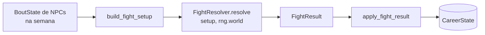

# CAREER ARCHITECTURE — Projeto Jaula

> Versão 0.1 · Etapa 02 · Volta ao [overview](ARCHITECTURE_OVERVIEW.md)
> Regras de gameplay: [CAREER_DESIGN.md](../CAREER_DESIGN.md).

---

## 1. Domínios e separação

| Domínio | Classe(s) em `src/domain/career/` e `world_sim/` | Responsabilidade | Dados (em `CareerState`) |
|---|---|---|---|
| Perfil do jogador | `PlayerProfile` | Finanças, plano de treino, Perfil Público, scouting ativo | `career.player` |
| Lutadores do mundo | `FighterRepository` | Guardar e buscar `FighterState` por ID; índices por categoria/organização/LOD | `career.fighters` |
| Estado da carreira | `CareerState` | Raiz de todo o estado; data; RNG; contadores de ID; notificações | — |
| Calendário | `CalendarSystem` | Datas, agenda, semana da luta, paradas do avanço rápido | `career.calendar` |
| Organizações e eventos | `OrganizationSystem` | Gerar eventos pelo calendário da organização, cards, campeões, títulos interinos | `career.organizations`, `career.events` |
| Contratos | `ContractSystem` | Propostas, negociação, cumprimento, dispensas, free agency | `career.contracts` |
| Matchmaking | `MatchmakingSystem` | Ofertas ao jogador e casamento de lutas de NPCs nos cards | `career.offers`, cards |
| Rankings | `RankingSystem` | Pontos por luta, ordenação, inatividade | `organizations[*].rankings` |
| Treinamento | `TrainingSystem` | Blocos, ganhos, Fadiga, scouting | `FighterState` |
| Saúde e idade | `HealthSystem`, `AgingSystem` | Lesões, suspensão, Desgaste, declínio mensal | `FighterState.health` |
| Peso | `WeightSystem` | Corte, pesagem, falhas, mudança de categoria | `FighterState`, eventos |
| Economia | `EconomySystem` | Receitas, despesas, dívida | `career.player.finances` |
| Reputação e mídia | `ReputationSystem`, `MediaSystem` | Prestígio, Popularidade, relações, rivalidades, Perfil Público | `FighterState.reputation`, `career.rivalries` |
| Simulação dos NPCs | `WorldSimulator`, `FightResolver`, `FighterGenerator` | LOD, lutas simuladas, novos atletas, aposentadorias NPC | `career.fighters`, resultados |
| Histórico e legado | `HistorySystem`, `LegacySystem` | Linha do tempo, cartel, Hall da Fama | `career.history` |

**Padrão comum dos sistemas** (sem classe-base obrigatória; só convenção):
```gdscript
class_name TrainingSystem extends RefCounted
func _init(defs: Definitions, balance: BalanceConstants) -> void: ...
func run_week(career: CareerState, rng: RandomNumberGenerator) -> Array[Notification]: ...
```
Cada sistema escreve **só no próprio domínio** e lê o resto. O `CareerController` (camada de aplicação) é a fachada para a UI: métodos de ação do jogador (`set_training_plan`, `accept_offer`, `counter_offer`, `answer_media`, `retire`) que validam e delegam.

---

## 2. Tick semanal — WeekSimulator

```text
WeekSimulator.simulate_week(career):
  rng = career.rng_streams
  notes = []
  notes += training.run_week(career, rng.training)          # 1 treino (jogador detalhado; NPCs conforme LOD)
  notes += health.run_week(career, rng.health)              # 2 cura, lesões de treino, suspensões
  notes += organizations.run_week(career, rng.world)        # 3a eventos da semana: casa lutas pendentes
  results = world.resolve_week_bouts(career, rng.world)     # 3b lutas de NPCs → FightResult (resolvedor)
  for r in results: apply_fight_result(career, r)           # mesmo caminho da luta jogada (§4)
  notes += rankings.run_week(career)                        # 4 rankings
  notes += matchmaking.run_week(career, rng.world)          # 5 ofertas e cards futuros
  notes += economy.run_week(career)                         # 6 receitas/despesas semanais
  notes += reputation.run_week(career)                      # 7 decaimento/crescimento
  if calendar.is_first_week_of_month(career): notes += aging.run_month(career, rng.health)   # 8
  notes += world.run_population(career, rng.world)          # geração/aposentadoria (mensal)
  calendar.advance(career)                                  # 9 semana += 1
  career.notifications.append_array(notes)
  return WeekReport(notes, stop_reasons = calendar.stop_reasons(career))
```
- A ordem segue GAME_SYSTEMS §4 e elimina dependências circulares no mesmo tick.
- **Paradas do avanço rápido** (oferta, lesão, semana da luta) vêm no `WeekReport`; o `CareerController` para de avançar quando houver.
- Semana com luta do jogador: o tick para **antes** do passo 3 dessa semana; a luta é jogada; o resultado entra por `apply_fight_result`; o tick continua.

---

## 3. Simular o mundo sem rodar o combate

| Técnica | Efeito |
|---|---|
| **Resolvedor estatístico** (`FightResolver`) | Lutas de NPCs resolvidas round a round por comparação de forças por fase (em pé/clinch/solo), Fôlego estimado, Queixo/Desgaste e sorteios controlados. Custo: microssegundos por luta, sem `CombatSim` |
| **Fórmulas compartilhadas** | `FightResolver` usa as mesmas funções derivadas de `fighters/derived_stats.gd` (alcance, eficiência técnica, limiar de choque base) que o combate usa — coerência por construção |
| **Mesmo contrato** | Recebe `FightSetup`, produz `FightResult` idêntico ao do combate jogado (com estatísticas resumidas) |
| **LOD** | Detalhado (treino semanal simplificado), Agregado (evolução mensal por fórmula), Estatístico (trimestral). Promoção/rebaixamento de LOD no passo de população |
| **Orçamento de tempo** | Simular várias semanas: uma semana por frame ou fatias de ~8 ms (T-016); threads só se a medição em E-08 mostrar necessidade |
| **Calibração** | Ferramenta em `tools/sim_reports/`: compara distribuição de métodos do resolvedor com lotes de lutas IA×IA do `CombatSim` (marco M3) |



---

## 4. Aplicação de um FightResult

Ponto de entrada **único** para lutas jogadas e simuladas:
```text
CareerController.apply_fight_result(result):   # delega para FightResultApplier (domínio)
  bout = career.bouts.get(result.bout_id)
  bout.result = result                                  # registra
  health.apply_fight(career, result)                    # suspensão, lesões, Desgaste, cortes
  economy.apply_fight(career, result)                   # bolsa, bônus, % da equipe, multas de peso
  rankings.apply_fight(career, result)                  # pontos
  reputation.apply_fight(career, result)                # Prestígio, Popularidade, rivalidade por decisão controversa
  contracts.apply_fight(career, result)                 # lutas restantes, cláusula de campeão, risco de dispensa
  organizations.apply_fight(career, result)             # cinturão
  history.apply_fight(career, result)                   # cartel, linha do tempo, legado
  fighters.update_experience(career, result)            # QI de Luta/Compostura por experiência
  return notifications
```
- A carreira **não importa** nada de `combat_core` além dos tipos de contrato em `contracts/`.
- Para a luta do jogador, o fluxo é: `CombatController.fight_finished(result)` → tela de resultado → `GameSession.career.apply_fight_result(result)` → autosave pós-luta.

---

## 5. Exemplo: uma semana de carreira simulada
```text
Semana 142 (camp, 3 semanas para a luta). Jogador clica "Simular semana".
1. CareerController.simulate_week() → valida plano (12 blocos, sem treino bloqueado por Fadiga > 90)
2. TrainingSystem: 2 blocos de Estudo do Adversário → ScoutingReport.precision 0,55 → 0,70;
   4 blocos técnicos de boxe → Boxe +0,42; Fadiga 58 → 66
3. HealthSystem: sorteio de lesão de treino com risco ×1,5 (Fadiga 41–70) → sem lesão
4. OrganizationSystem/WorldSimulator: 3 eventos na semana → 31 lutas de NPCs resolvidas
   → próximo adversário vence? Não: ele não luta nesta semana; um rival do top 5 perde por KO
5. RankingSystem: jogador sobe de #9 para #8 (inatividade de outro)
6. MatchmakingSystem: nenhuma oferta (jogador já tem luta marcada)
7. EconomySystem: custo de vida + mensalidade (1ª semana do mês) + nutricionista do camp
8. ReputationSystem: Popularidade −0,1 (decaimento semanal sem luta)
9. AgingSystem: 1ª semana do mês → jogador (31 anos, pico 30) Velocidade −0,3
10. WeekReport → Dashboard mostra 4 notificações; autosave de início de semana na semana 143
```

## 6. Exemplo: um treinamento alterando os dados dinâmicos
```text
TrainingSystem.run_week(career, rng):
  f = career.fighters.get(career.player.fighter_id)
  for block in career.player.training_plan.blocks:
      act = defs.training_activity(block.activity_id)           # TrainingActivityDef (somente leitura)
      for attr_id in act.gains:
          gain = act.gains[attr_id] * coach_mult(attr_id) * gym_mult(attr_id)
               * fatigue_factor(f.health.fatigue) * age_factor(f) * ceiling_factor(f, attr_id)
          f.attributes[attr_id] = min(f.attributes[attr_id] + gain, f.hidden.potential[attr_id])
      f.health.fatigue += act.load
  apply_decay_for_untrained(f)                                   # Condicionamento cai rápido sem blocos
  return [Notification.training_summary(deltas)]
```
Nada na definição muda; só `FighterState`. Teste: plano "tudo no máximo" por 4 semanas resulta em Fadiga > 70 e ganhos menores que um plano equilibrado (REQ-09).

---

## 7. Integração com o combate (resumo)
| Momento | Quem | O quê |
|---|---|---|
| Antes da luta | `CareerController.build_fight_setup(bout_id)` | Snapshots, modificadores do dia (`WeightSystem`, `HealthSystem`, Fadiga), RuleSet da organização, perfil de IA do adversário (QI de Luta e experiência), scouting, semente do fluxo da luta |
| Luta jogada | `CombatScene` | Não acessa `CareerState` |
| Depois | `apply_fight_result` | §4 |
| Luta Rápida | `QuickFightSetupBuilder` | Mesmo `FightSetup`, lutadores do "mundo-modelo" (dados em `data/world_seed/`) ou de um save aberto em modo somente leitura |

---

## 8. Riscos específicos da carreira
| Risco | Mitigação na arquitetura |
|---|---|
| `CareerController` virar classe gigante | Ele só valida e delega; regras ficam nos sistemas; limite de ~400 linhas como alerta |
| Sistemas lendo estado inconsistente | Ordem fixa do tick; cada sistema escreve só no próprio domínio |
| Desempenho com 600–800 lutadores | LOD, índices no repositório, simulação fatiada; medir em E-08 com relatório |
| Incoerência resolvedor × combate | Fórmulas compartilhadas + calibração M3 |
