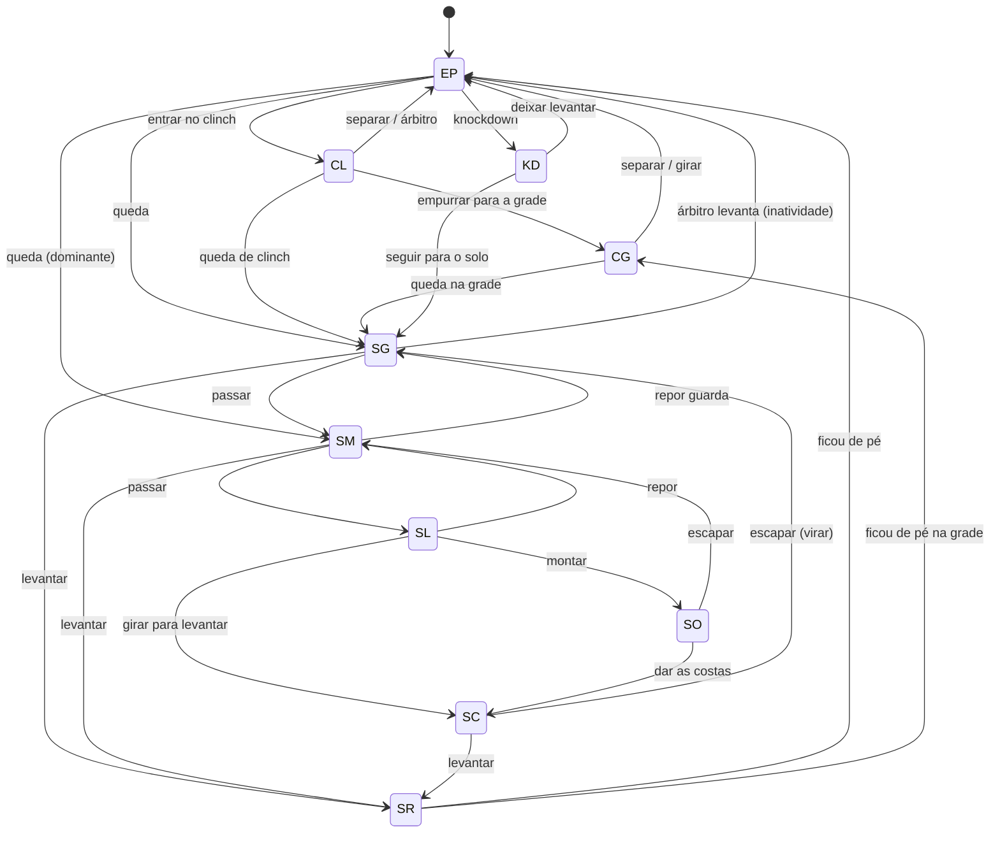
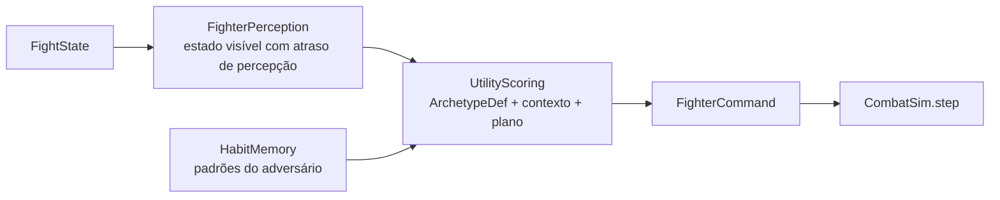

# COMBAT ARCHITECTURE — Projeto Jaula

> Versão 0.1 · Etapa 02 · Volta ao [overview](ARCHITECTURE_OVERVIEW.md)
> Regras de gameplay: [COMBAT_DESIGN.md](../COMBAT_DESIGN.md). Este documento só define **como** organizá-las.

---

## 1. Módulos do combate

| Módulo (arquivo em `src/domain/combat/`) | Responsabilidade | Lê | Escreve |
|---|---|---|---|
| `combat_sim.gd` — **CombatSim** | Orquestra o passo fixo, a ordem dos subsistemas, as fases da luta; monta `FightResult` | tudo | `FightState` |
| `fight_state.gd` | Estado do par: fase, round, relógio, posição, papéis, estatísticas | — | — |
| `fighter_combat_state.gd` | Estado individual (ação, X/Z, Fôlego, dano…) e `set_action()` que valida transições de ação | — | — |
| `movement.gd` | Movimento X/Z, orientação, distância, ângulo, grade, troca de lado | estado, `WeightClassDef`, atributos | posições |
| `striking.gd` | Iniciar golpe, avançar fases, encadear, fintar, resolver acerto (geometria) | `StrikeDef`, posições | eventos de acerto/erro |
| `defense.gd` | Guarda, esquivas, check; mitigação | comandos, estado | modificadores de mitigação |
| `grappling/position_machine.gd` | Estado de posição do par; aplica transições válidas da tabela | `PositionStateDef`, `GrappleTechniqueDef` | posição, papéis |
| `grappling/contest.gd` — **Disputa** | Janela de leitura, pressão × resistência, progresso parcial | atributos, Fôlego | resultado da disputa |
| `grappling/submissions.gd` | Encaixe → Aperto → resultado | `SubmissionDef` | medidor, fim de luta |
| `physiology.gd` | Custos de Fôlego, regeneração, Reserva, dano por zona, Limiar de Choque, cortes, intervalo | `BalanceConstants`, atributos | Fôlego, dano, estados de choque |
| `referee.gd` | Inatividade, separação, TKO, faltas acidentais, revisão médica | `RuleSetDef`, estado | eventos de árbitro, fim |
| `combat_stats.gd` | Contadores por round (golpes, controle, ameaças) | eventos | estatísticas |
| `src/domain/rules/judging.gd` | Juízes: pontuação por round a partir das estatísticas | estatísticas, perfis | placar |
| `contracts/*` | `FightSetup`, `FightResult`, `FighterCommand`, `CombatEvent`, `FighterPerception` (visão filtrada para IA) | — | — |
| `src/domain/combat_ai/*` | IA por utilidade, percepção com atraso, memória de hábitos | `FighterPerception` | `FighterCommand` |

Nenhum desses arquivos estende `Node`.

---

## 2. Modelo de atualização — `RECOMENDAÇÃO T-004`

**Escolha:** simulação própria em **passo fixo de 60 Hz**, determinística, com **geometria própria** (intervalos em X, Z e altura), sem usar `Area2D`/física da Godot para regras.

| Alternativa | Por que não |
|---|---|
| Lógica em `_process` com delta variável | Fases de golpe são definidas em quadros (COMBAT §3.3); delta variável quebra timing e replay |
| Física da Godot (`Area2D`, `CharacterBody2D`) para acertos | O mundo lógico é 2D de chão (X/Z) + altura, diferente da tela; colisões de física acoplam regra à cena e não são testáveis headless de forma simples |
| Animação dirigindo regras (eventos de `AnimationPlayer` liberando o acerto) | Pipeline de arte pendente; regra mudaria a cada retoque de animação |

**Ordem de um passo** (fixa; cada subsistema lê o que os anteriores deixaram):
```
step(cmd_a, cmd_b):
  1. se fase != ROUND: return
  2. aplicar comandos (buffer de entrada → intenção válida para a ação atual)
  3. movement.update()             # posições, distância, ângulo, encurralado
  4. grappling.update()            # disputas em andamento, transições, aperto
  5. striking.update()             # avança fases, detecta acertos (geometria)
  6. defense.resolve(hits)         # mitigação
  7. physiology.apply(hits, costs) # Fôlego, dano, choque → estados (atordoado, KD, apagão)
  8. referee.update()              # inatividade, TKO, interrupções
  9. stats.record(events); relógio += 1/60
 10. checar fim de round/luta → StepResult(events, round_over, fight_over)
```

---

## 3. Estados e transições

### 3.1 Três níveis de estado
| Nível | Dono | Valores | Objetivo |
|---|---|---|---|
| `FightPhase` | `FightState` | INTRO, ROUND, ROUND_BREAK, FINISHED | Quando a simulação roda |
| **Posição do par** | `FightState` | EP, CL, CG, SG, SM, SL, SO, SC, SR, KD + **papéis** (quem está por cima/prensando) | Estado de grappling — **um só para os dois lutadores** |
| `FighterActionState` | cada `FighterCombatState` | IDLE, MOVING, STRIKE_STARTUP, STRIKE_ACTIVE, STRIKE_RECOVERY, EVADING, BLOCKING, GRAPPLE_ATTEMPT, CONTESTING, STUNNED, DOWN, OUT | O que o lutador está fazendo agora |

**Por que a posição é do par:** se cada lutador tivesse sua própria posição, seria possível um "em Montada por cima" enquanto o outro está "Em pé". Com um único estado do par + papéis, combinações inválidas **não são representáveis**.

### 3.2 Ações permitidas por posição
Cada `PositionStateDef` lista as ações permitidas por papel (golpes por categoria, técnicas de grappling). `FighterCombatState.set_action()` recusa ações que a posição atual não permite (ex.: chute alto no solo). Assim a validação fica em **um lugar**.

### 3.3 Transições dirigidas por dados
- Uma transição de posição só acontece por um `GrappleTechniqueDef` (de/para/papel/direção) cuja Disputa teve sucesso, por um evento de regra (knockdown → KD; árbitro levanta → EP) ou por fim de finalização.
- `PositionMachine.apply(technique, outcome)` é a **única** função que muda a posição.
- Teste obrigatório: carrega todas as técnicas e verifica que (a) todo estado tem pelo menos uma saída para cada papel, (b) todo estado é alcançável a partir de EP, (c) nenhuma técnica referencia estado inexistente.


Raspagens (inversão de papéis no mesmo estado ou para outro estado) são transições com `invert_roles = true`; omitidas do diagrama para legibilidade.

---

## 4. Movimento e posicionamento

- Unidades lógicas em **metros** (`float`): `x` (eixo da distância) e `z` (profundidade). Nada em pixels no domínio.
- `movement.gd` calcula: distância em X, faixa de distância (fora/chute/soco/curta/clinch) com base no alcance dos dois lutadores, diferença de Z, Vantagem de Ângulo (temporizador), encurralado (distância à grade), orientação e troca de lado (só via ação "circular" ou transição com troca).
- Colisão de corpos: intervalo mínimo em X ajustado por |ΔZ| (permite passar "ao lado" sem atravessar; COMBAT §2.6).
- **Posição visual** é responsabilidade da apresentação (§10.2).

---

## 5. Golpes e defesa

- Golpe = `StrikeDef` (dados) + instância transitória `ActiveStrike` (quadro atual, alvo escolhido, encadeado?).
- **Acerto** é decidido por geometria no quadro ativo: alcance efetivo em X, tolerância em Z, altura do alvo vs. ação do defensor (abaixar, recuar). Resultado: `MISS_RANGE`, `MISS_ANGLE`, `EVADED`, `BLOCKED`, `CLEAN`, `COUNTER` — os mesmos rótulos que o HUD mostra (COMBAT §8.2). Assim o feedback "por que falhou" sai direto da regra.
- Atributos modulam números (quadros, potência, desvio) por funções em `fighters/derived_stats.gd`, compartilhadas com o resolvedor estatístico.

---

## 6. Grappling: a Disputa

```text
Contest (transitório)
  attacker, defender, technique_def
  window_frames = technique.startup - perception_delay(defender)   # jogador: 0 extra; IA: perfil cognitivo
  defender_read: Direction | NONE  (registrada quando o comando chega dentro da janela)
resolve():
  if defender_read == technique.direction: return READ (perfect se no início da janela)
  pressure   = attr(attacker, technique.pressure_attr)   * stamina_factor(attacker) * position_bonus
  resistance = attr(defender, technique.resistance_attr) * stamina_factor(defender) * weight_ratio
  ratio = pressure / resistance → SUCCESS | PARTIAL | FAIL   (limiares em BalanceConstants)
```
- Disputas e o Aperto da finalização usam o mesmo `contest.gd` e as mesmas entradas (direção de técnica), conforme R-009/R-010.
- O `CombatEvent` da disputa carrega o rótulo `READ`/`RESISTED`/`PASSED` para o feedback.

---

## 7. Dano e Fôlego

- `physiology.gd` é a única fonte de alteração de Fôlego, Reserva, dano por zona e estados de choque.
- Modificadores do dia (corte de peso, Fadiga, lesão em retorno precoce) entram via `FightSetup` e são aplicados no início (Reserva inicial, Queixo efetivo) — nunca mudam definições.
- Intervalo: `physiology.apply_round_break(foco_tático)` aplica as recuperações de COMBAT §6.5.
- Saída para a carreira: dano final por zona, knockdowns sofridos, cortes, pontos de chave articular sob pressão → `FightResult.medical`.

---

## 8. Arbitragem e julgamento

- `referee.gd` roda dentro do passo (inatividade, TKO, médico, faltas acidentais).
- `judging.gd` é chamado no fim de cada round com `RoundStats` + perfis de juízes (pesos e ruído do fluxo de RNG da luta) → placar 10-9/10-8. É função pura: testável com estatísticas fabricadas.

---

## 9. IA de combate


- **Justiça por construção:** a IA recebe um `FighterPerception`, não o `FightState`. O `FighterPerception` contém apenas o que é visível (posições, ação visível do adversário com **atraso** = histórico de N passos atrás conforme o perfil, barras que o HUD também mostra). Não contém comandos do jogador, atributos ocultos nem o RNG.
- A IA devolve o **mesmo** `FighterCommand` que o `PlayerInputController`. O `CombatSim` não sabe quem controla quem.
- Frequência de decisão por perfil (100–250 ms) — a IA não decide todo passo.
- Plano do round recalculado em `ROUND_BREAK`.

---

## 10. Integração com animação, HUD, efeitos e áudio

### 10.1 Fluxo
```
CombatController (_physics_process)
  ├─ cmds = [input.get_command(perception_a), ai.get_command(perception_b)]
  ├─ res  = sim.step(cmds)
  ├─ for fighter_view in views: fighter_view.present(sim.snapshot_of(i))
  ├─ fx.spawn_for(res.events)       # faíscas, poeira, hit-stop (pede ao controller para pular N passos)
  ├─ hud.present(sim.hud_snapshot(), res.events)
  └─ audio: sfx por evento (mapa evento → som em dados de apresentação)
```

### 10.2 Posição lógica × visual
```
screen_x = floor_origin_x + x_m * PIXELS_PER_METER            # PPM ≈ 78 px/m para lutador de 1,80 m ≈ 140 px [PROV, depende de R-003]
screen_y = floor_line_y   - z_m * DEPTH_PIXELS_PER_METER      # faixa Z (≈2,5–3 m) ocupa ≈40–60 px [PROV]
ordem de desenho: maior z (mais ao fundo) desenha antes; empate → lutador em ação ofensiva na frente
sombra: elipse no ponto (screen_x, screen_y), tamanho constante
```
- O sprite **não escala** com Z (ART §7). A profundidade afeta só o deslocamento vertical, a ordem e a sombra; alcance e colisão são calculados no domínio com metros.
- Posições visuais arredondadas para pixel inteiro na hora de desenhar.

### 10.3 Animação
- `FighterView.present(snapshot)` escolhe a animação pelo par (ação, posição/papel) e o **quadro** pelo progresso da fase (`frames_elapsed / frames_total`) → a animação acompanha os dados, nunca o contrário (ART §6.1).
- Greybox: a mesma interface desenha formas coloridas (membro ativo destacado, zonas de acerto no modo de depuração).
- Animações de solo por papel são posicionadas por **pontos de âncora** do `BiotypeDef`.

### 10.4 HUD
- Recebe `HudSnapshot` (Fôlego/Reserva, dano por zona, relógio, opções de grappling disponíveis, medidor de aperto) + eventos para textos curtos. Nível de HUD vem de `Settings`.

---

## 11. Testar o combate sem a cena visual

| Teste | Como |
|---|---|
| Unidade por subsistema | Instanciar `FightState` mínimo + definições de teste em memória; chamar `movement.update()`, `contest.resolve()` etc. |
| Luta completa headless | `CombatSim` + duas IAs, rodar até o fim sem nenhum nó; checar invariantes (Fôlego ∈ [0, Reserva], posição válida, relógio monotônico, luta termina) |
| Replay de regressão | Semente + lista de comandos gravada → `FightResult` e *hash* do estado final esperados (fixture) |
| Lote estatístico | 1.000 lutas IA×IA por categoria → distribuição de métodos (insumo para calibrar o resolvedor, M3) |
| Justiça da IA | Verificar que `FighterPerception` não expõe campos proibidos e que a reação nunca ocorre antes do atraso mínimo |

---

## 12. Exemplo: uma luta iniciada e finalizada
```text
1. CareerController.build_fight_setup(bout_id) → FightSetup{snapshots A/B, mods do dia, ruleset_id,
   controle A=PLAYER, B=AI(perfil, arquétipo, plano), seed, contexto(título, card, arena_id), scouting}
2. SceneRouter.go_to(&"combat", {setup = setup})
3. CombatScene._ready: CombatController cria CombatSim(setup, defs), AIController(B), liga views ao snapshot
4. Fase INTRO (apresentação) → ROUND 1 → passos a 60 Hz …
5. Round termina: judging.score_round() ; fase ROUND_BREAK ; RoundBreakUI mostra stats e dicas
6. Jogador escolhe foco → sim.begin_next_round(foco)
7. Round 3, 2:41: submissions → TAP → fase FINISHED
8. result = sim.build_result()  → FightResult{winner=A, method=SUBMISSION(rear_naked_choke), round=3,
   time=2:41, scorecards parciais, stats, medical{dano por zona, KDs, cortes}, injuries=[]}
9. CombatController.fight_finished.emit(result) → roteamento pós-luta → CareerController.apply_fight_result(result)
10. CombatScene é liberada; nada do FightState persiste.
```
