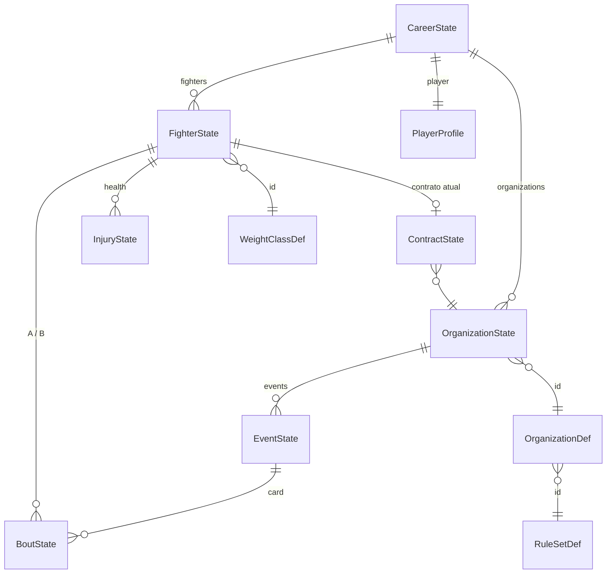

# DATA ARCHITECTURE — Projeto Jaula

> Versão 0.1 · Etapa 02 · Volta ao [overview](ARCHITECTURE_OVERVIEW.md)
> Exemplos são **estruturas conceituais em pseudo-GDScript**, não implementação.

---

## 1. Três tipos de dados

| Tipo | O que é | Representação | Muda durante o jogo? | Persistido em |
|---|---|---|---|---|
| **Definições estáticas** | Conteúdo e regras balanceáveis | `Resource` personalizados (`XxxDef`) em `data/*.tres` | **Nunca** | Repositório (parte do jogo) |
| **Estado dinâmico de carreira** | Tudo que evolui em uma carreira | Classes `RefCounted` com `to_dict()/from_dict()` | Sim | Save da carreira (JSON) |
| **Estado transitório** | Existe só durante uma luta ou tela | Classes `RefCounted` (`FightState`) | Sim | Nunca (só o `FightResult` sai) |

Dados globais fora da carreira (configurações) usam `ConfigFile` em `user://settings.cfg`.

---

## 2. Definições estáticas (SYS-28)

| Definição | Campos principais (resumo) | Fonte de design |
|---|---|---|
| `AttributeDef` | id, nome (chave de localização), grupo (físico/durabilidade/em pé/agarrado/mental), visível/oculto, treinável, decaimento | CHARACTER §2–3 |
| `WeightClassDef` | id, divisão, nome, limite_lb, tolerância_lb, biotipos permitidos, multiplicadores de massa (dano, custo de movimento, velocidade), distribuições de altura/envergadura | CHARACTER §6 |
| `RuleSetDef` | rounds normal/título, duração, intervalo, golpes proibidos (IDs), sistema de pontuação, tempos de inatividade, regras de pesagem e multas, suspensões médicas, round mínimo para decisão técnica | COMBAT §7, CAREER §5.2, §6.2 |
| `OrganizationDef` | id, nome, nível, região, categorias (IDs), ruleset (ID), calendário (frequência, rodízio), faixas de bolsa, regras de contrato e dispensa, tamanho do ranking, procedural? | CAREER §7–9 |
| `StrikeDef` | id, membro, variante (reto/curvo/corpo), alvos, faixa, alcance-base, tolerância Z, quadros de preparação/execução/recuperação, janela de encadeamento, ponto-limite de finta, potência, custo de Fôlego, atributo técnico, chance de corte | COMBAT §3.2–3.5 |
| `PositionStateDef` | id (EP, CL, CG, SG...), papéis, multiplicador de GnP por papel, contribui para tempo de controle?, árbitro levanta/separa após N s | COMBAT §4.1, §4.5 |
| `GrappleTechniqueDef` | id, estado de origem, papel exigido, direção, estado de destino (sucesso), estado de destino (contra), preparação, atributo de pressão, atributo de resistência, custo de Fôlego (sucesso/falha), bônus de posição | COMBAT §4.2–4.5 |
| `SubmissionDef` | id, estados de origem, tipo (estrangulamento/chave), atributo de ataque/defesa, taxa do Aperto, escapes necessários, estado após escape, lesão possível | COMBAT §4.6 |
| `ArchetypeDef` | id, pesos de ação, plano de jogo padrão, regras de ajuste entre rounds | COMBAT §9.3 |
| `CognitiveProfileDef` | atraso de percepção, erro de leitura, hesitação, memória, temperatura | COMBAT §9.5 |
| `TrainingActivityDef` | id, ganhos por atributo, Carga, risco de lesão, custo, requisitos (luta marcada, parceiros) | CAREER §4.1 |
| `GymDef`, `CoachDef` | especialidades, estrutura, custo, exigência, localização / competências, custo | CAREER §4.4–4.5 |
| `OriginDef` | atributos-base, faixas ocultas, dinheiro inicial, academias acessíveis | CAREER §2.3 |
| `InjuryTypeDef` | local, gravidade, semanas min/máx, atributos afetados, chance de crônica | CAREER §5.1 |
| `MediaQuestionDef` | contexto, respostas com tom e efeitos | CAREER §10.5 |
| `BiotypeDef` | id, divisão, altura em px, pasta de spritesheets, pontos de âncora | ART §5 |
| `BalanceConstants` | todos os `[PROV]` globais (faixas de Fôlego, limiares de choque, multiplicadores, fórmulas de ganho e idade) | todos |

**Regra:** número de balanceamento que aparece em código é bug; deve estar em uma definição ou em `BalanceConstants` (exceção: constantes matemáticas e de unidade).

### 2.1 Exemplo conceitual
```gdscript
# src/definitions/strike_def.gd  (conceitual)
class_name StrikeDef extends Resource
@export var id: StringName                # &"jab"
@export var limb: Limb                    # enum: LEAD_HAND, REAR_HAND, LEAD_LEG, REAR_LEG
@export var variant: StrikeVariant        # STRAIGHT, CURVED, BODY
@export var targets: Array[Zone]          # HEAD, BODY, LEGS
@export var base_reach_m: float           # [PROV]
@export var depth_tolerance_m: float      # [PROV]
@export var startup_frames: int
@export var active_frames: int
@export var recovery_frames: int
@export var chain_window_frames: int
@export var feint_cutoff: float           # fração da preparação
@export var power: float
@export var stamina_cost: float
@export var technique_attribute: StringName   # &"boxe"
func validate(defs) -> Array[String]: ...     # retorna erros; chamada pelo DataRegistry
```

---

## 3. Estado dinâmico

### 3.1 Entidades de carreira
| Entidade | ID | Contém (resumo) | Referencia |
|---|---|---|---|
| `CareerState` | slot | data atual, semente e fluxos de RNG, ID do lutador do jogador, coleções abaixo, notificações pendentes, `FightWeekStep` | tudo |
| `FighterState` | `F-000123` | identidade, físico, atributos (`Dictionary attr_id → float`), ocultos, estilo derivado em cache, saúde, peso de caminhada, cartel, reputação, relações, contrato atual (ID), academia (ID), equipe (IDs), LOD | `WeightClassDef`, `GymDef`, `OrganizationDef` por ID |
| `PlayerProfile` | — | dados só do jogador: finanças, Perfil Público, plano de treino, plano padrão, scouting ativo | `FighterState` do jogador |
| `OrganizationState` | `org_gcl` (= ID da definição) | campeões por categoria, rankings, eventos futuros/passados (IDs), relação por lutador | `OrganizationDef` |
| `EventState` | `E-2027-03-gcl-12` | data, organização, card (lutas), estado (agendado/realizado/cancelado) | `BoutState` |
| `BoutState` | `B-000456` | lutadores A/B, categoria, rounds, título?, posição no card, resultado (`FightResult` serializado) | `FighterState`, `EventState` |
| `ContractState` | `C-000078` | lutador, organização, lutas restantes, bolsas, cláusulas | `FighterState`, `OrganizationDef` |
| `FightOffer` | `O-000031` | adversário, evento, prazo, bolsa, expira em | — |
| `InjuryState` | dentro de `FighterState` | tipo (ID), local, semanas restantes, crônica? | `InjuryTypeDef` |
| `RivalryState` | `R-000005` | par de lutadores, intensidade, origem | `FighterState` |
| `NewsItem` | — | texto (chave de localização + parâmetros), data | — |

### 3.2 Estado transitório da luta
| Entidade | Contém |
|---|---|
| `FightState` | fase, round, relógio, estado de posição do par, papéis, `FighterCombatState` × 2, estatísticas do round e da luta, placar dos juízes, fluxo de RNG da luta |
| `FighterCombatState` | posição X/Z, orientação, base, ação atual (+ quadros restantes), Fôlego, Reserva, dano por zona (agudo/residual), cortes, choque, vantagem de clinch, medidor de aperto, buffer de comandos, modificadores do dia |

### 3.3 Exemplo conceitual
```gdscript
# src/domain/fighters/fighter_state.gd  (conceitual)
class_name FighterState extends RefCounted
var id: StringName                     # &"F-000123"
var display_name: String
var division: Division                 # MALE / FEMALE
var weight_class_id: StringName        # &"m_lightweight" — ID, nunca o Resource
var birth_week: int                    # semanas desde o início do calendário
var physique: Physique                 # altura_cm, envergadura_cm, peso_caminhada_kg, biotipo_id, base
var attributes: Dictionary             # StringName -> float (1..100); arredondado só na UI
var hidden: HiddenTraits               # potencial por atributo, pico_fisico, fragilidade, metabolismo
var health: HealthState                # lesões, desgaste, fadiga, unavailable_until_week
var record: FightRecord                # vitórias/derrotas/empates, lista de bout IDs
var reputation: ReputationState
var contract_id: StringName            # &"" se agente livre
var gym_id: StringName
var lod: SimLod                        # DETAILED / AGGREGATE / STATISTICAL

func to_dict() -> Dictionary: ...
static func from_dict(d: Dictionary) -> FighterState: ...
```
Atributos ficam em `float` internamente (ganhos semanais pequenos acumulam) e aparecem arredondados.

---

## 4. Proteção das definições contra alteração

Problema: `Resource` carregado é **compartilhado** por toda a engine; uma escrita acidental (`strike.power *= 2` para um "buff temporário") contamina todas as lutas e persiste até reiniciar.

| Medida | Como |
|---|---|
| Estado só guarda **IDs** | `FighterState.weight_class_id`, nunca `weight_class: WeightClassDef`. Impossível salvar uma definição alterada dentro do save |
| Modificadores ficam no estado | Penalidade de lesão, corte de peso, Fadiga = campos do `FighterCombatState`/`FighterState`, aplicados por cálculo, nunca escrevendo na definição |
| Convenção de código | Proibido atribuir campos de `XxxDef` fora de `src/definitions/` e de ferramentas (`CODING_STANDARDS`) |
| Verificação automática | Teste de integração: calcula um *hash* de todas as definições ao carregar, roda uma luta completa e uma carreira de 2 anos simuladas, recalcula o *hash* e falha se mudou |
| Modo de depuração | `DataRegistry` em builds de depuração pode guardar o hash e verificar ao fechar cada luta |

---

## 5. Identificadores

| Tipo | Formato | Gerado por | Estável entre versões? |
|---|---|---|---|
| Definições | `StringName` legível (`&"jab"`, `&"m_lightweight"`, `&"org_gcl"`) | Autor dos dados | **Sim.** Renomear exige migração de save |
| Entidades geradas | Prefixo + contador por carreira (`F-000123`, `B-000456`, `C-000078`) | `IdGenerator` dentro do `CareerState` (contador salvo) | Sim dentro da carreira |
| Datas | Inteiro de semanas desde o início do calendário (`week_index`); dia só dentro da semana da luta | Calendário | Sim |

- Referências entre entidades são **sempre por ID**, resolvidas por repositórios (`career.fighters.get(id)`), nunca por referência direta de objeto na serialização. Em memória, cache de referência é permitido, mas não serializado.
- IDs de definições ausentes ao carregar um save (ex.: golpe removido) são tratados pela migração ou geram erro de validação claro.

---

## 6. Relações principais



---

## 7. Serialização

- Cada classe de estado implementa `to_dict()` e `static from_dict()`; tipos permitidos no dicionário: `int`, `float`, `String`, `bool`, `Array`, `Dictionary` (JSON puro). `StringName` vira `String`; enums viram **nome** (`"MALE"`), não número, para resistir a reordenação de enums.
- `CareerState.to_dict()` monta o documento completo; o `SaveSystem` adiciona o envelope ([SAVE_AND_TESTING §1](SAVE_AND_TESTING.md#1-persistência)).
- **Por que JSON e não `.tres`/`ResourceSaver` ou `var_to_bytes`:** (1) carregar `.tres` de `user://` permite que um arquivo modificado carregue scripts arbitrários — risco de segurança com saves compartilhados; (2) JSON é legível e "diffável", facilitando depurar e migrar; (3) formato independente de nomes de classes do código. Custo: escrever `to_dict/from_dict` à mão (aceito).
- Tamanho estimado: 600–800 lutadores com históricos → poucos MB de JSON; compactação gzip reduz bastante `[estimativa, medir em E-08]`.

---

## 8. Exemplo: um lutador carregando seus dados e configurações
```text
1. Ao iniciar o jogo, DataRegistry carrega data/** e valida (erros → log + falha em build de depuração).
2. Ao carregar a carreira, FighterState.from_dict(d) recria o estado com IDs.
3. Para entrar em uma luta, CareerController monta o snapshot:
     defs   = DataRegistry.definitions
     wc     = defs.weight_class(fighter.weight_class_id)
     biot   = defs.biotype(fighter.physique.biotype_id)
     mods   = FightDayModifiers.from(fighter.health, weight_cut_result, fatigue)
     entry  = FighterSnapshot.new(fighter.attributes.duplicate(), fighter.physique, mods, biot.id)
4. FighterSnapshot vai dentro do FightSetup. O combate recebe cópias de valores; nada do combate aponta
   para o FighterState da carreira.
```

---

## 9. Aleatoriedade e determinismo — `RECOMENDAÇÃO T-013`
- Fluxos de `RandomNumberGenerator` **separados por sistema** (treino, saúde, mundo, mídia, cada luta), todos derivados da semente da carreira e salvos (estado do gerador). Assim, mudar quantas vezes o treino sorteia não altera os sorteios das lutas do mundo, e bugs podem ser reproduzidos.
- A luta recebe sua própria semente no `FightSetup`; com a mesma semente e os mesmos comandos, o resultado é idêntico (base do teste de replay).
- **Pendente de validação:** determinismo de `float` entre máquinas não é garantido em todos os casos; para replays entre máquinas diferentes pode ser necessário arredondar estados por passo. Para testes na mesma máquina, suficiente.
